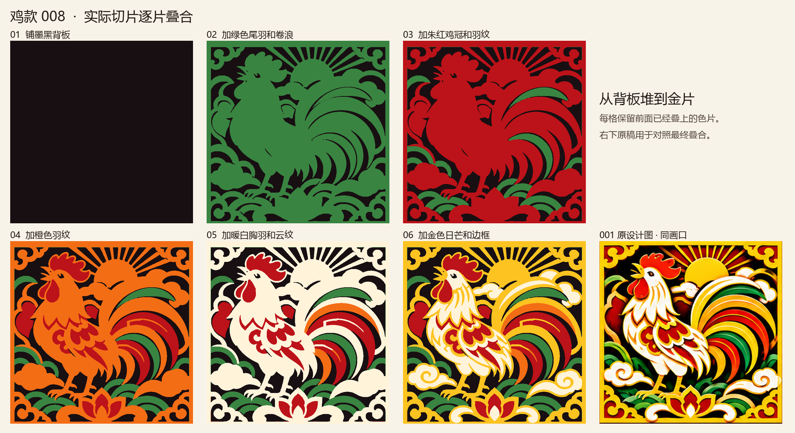

# FDM 分层剪纸

从一张参考图生成一套可拿起、装盒叠合的单色剪纸片。仓库提供已切片的鸡和龙成品，以及可用同一流程生成新款的任务模板。

[鸡款逐片叠合与原设计](examples/rooster/expected/鸡_逐片切片叠合与原设计.png) · [鸡款装盒渲染](examples/rooster/expected/鸡_装盒斜视.png) · [鸡款已切片 3MF](examples/rooster/expected/鸡_八盘_已切片可编辑.3mf) · [龙款成品](examples/dragon)



## 安装 Skill

把 [skills/fdm-layered-papercut](skills/fdm-layered-papercut/) 整个目录复制到 Codex 的个人技能目录 `~/.agents/skills/`，Windows 上为 `%USERPROFILE%\.agents\skills\`。也可复制到项目的 `.agents/skills/`。要执行下面的管线，请克隆整个仓库，并从仓库根目录运行命令。

## 先复跑鸡款

已附鸡款参考图、实际生图输出和配置，直接从保存的生图输出复跑。Windows 安装 Python 和 Bambu Studio，预览另需 Blender。当前工艺按 P1S／0.4 mm／PLA，180 mm 画口、六张 1.2 mm 色片、一件一盘。

```powershell
python -m pip install -r requirements.txt
python pipeline/run.py examples/rooster --out runs/rooster-001
```

Bambu Studio 路径不同时传 `--bambu <exe>`。需要装盒斜视时传 `--blender <exe>`。每次用新的输出目录。程序依次生成遮罩和网格、原生回读、实际切片、核验与逐片叠合。

## 裂变新款

1. 复制 [鸡款任务](examples/rooster)到 `jobs/新款/`，使用 `reference.png`、`art.png` 和 `job.json` 三个输入。将参考图换为用户认可的设计。
2. 按[生图交接规范](docs/IMAGE_INPUT.md)，调用支持参考图编辑的生图工具，将参考图与填写后的提示词一起传入。原图保存为 `reference.png`，选中输出保存为 `art.png`。
3. 填写 `job.json` 的款名、两张图各自的画口裁切坐标、从背向前六色及色片名。前片依据纹样连续性、接框条件和遮筋覆盖选定。将前片色放在色表末位，程序会用它清理裁切边缘。
4. 执行 `python pipeline/run.py jobs/新款 --out runs/新款-001`。查看正视、斜视及逐片切片图，发现露筋、失真或明显串色时回到对应的图稿、层序或开孔修改，再用新编号复跑。

## 交付

- `output/已切片可编辑.3mf` 是最终工程，六张色片、托框、压边各一盘。
- `evidence/逐片切片叠合与原设计.png` 按实际装配顺序逐片累加，最终图旁放同画口的原设计。
- `evidence/正斜视.png`、实际遮罩和两份核验 JSON 用于检查。传入 Blender 时另生成 `装盒斜视.png`。
- 交付时列出未解决的可见接点、细孔失真和实物验证状态。实物打印由使用者决定。

其他 AI 从 [AGENTS.md](AGENTS.md) 开始。当前入口采用可复跑的鸡款样板。

**贡献者**　小文不闻
